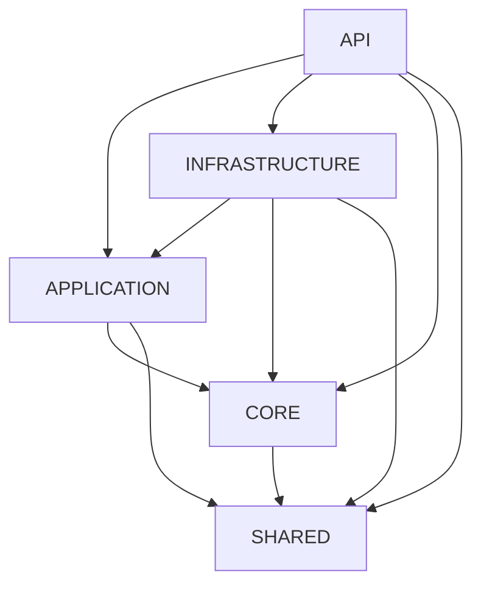
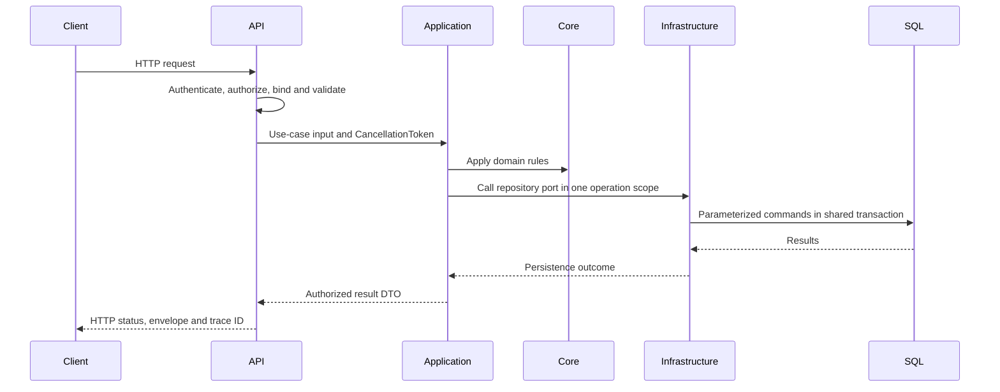

# Clean Architecture, REST, SOLID and workflow review

## Assessment

The solution is a working foundation with shared helpers and unit tests. CORE and APPLICATION currently contain project scaffolding, not banking entities or use cases. INFRASTRUCTURE provides SQL access and an abstract repository base. The public weather example is the only application endpoint. There is no complete banking request workflow to validate yet.

No application behavior, authentication, database schema, credentials or public contracts were changed by this review.

## Findings, ordered by priority

| Priority | Location | Finding and effect | Next action |
| --- | --- | --- | --- |
| High | Deployment/.env | The credential environment file is already tracked. New ignore rules do not remove tracked secrets. | Rotate any committed credentials and perform a reviewed index/history cleanup. |
| High | Deployment/compose.yaml | API connects as sa and trusts the server certificate. Compromise of an application connection grants administrator access; certificate identity is not checked. | Provision a restricted application login, trusted SQL certificate, and deployment secret configuration. |
| High before protected features | API/Program.cs | No authentication scheme or authorization policy is configured. | Implement authentication and resource access policies alongside the first protected feature; test 401, 403 and cross-user access. |
| Medium | SHARED/Base/DataAccess/IBaseRepository.cs; INFRASTRUCTURE/Base/Repository/BaseRepository.cs | GetPagedAsync reads count and items separately. Concurrent writes can make metadata inconsistent. If the observed count falls below the returned item count, PagedResult rejects the result and a request can become a 500. | Override with a consistent read snapshot when consistency is required; test concurrent writes against a disposable SQL database. |
| Medium | SHARED/Base/Services/BaseService.cs | ValidateInput runs DataAnnotations, but does not invoke PagedRequest.Validate. Offset-overflow validation is therefore absent on this service-validation path. The current repository paging entry points do call Validate. | Unify request validation before adding feature services; add a regression test for a very large page number. |
| Medium | SHARED/Base/Exceptions/DomainException.cs | DomainException embeds HTTP status codes. CORE has no ASP.NET dependency, but using these exceptions in domain rules still couples those rules to HTTP concepts. | For new domain rules use semantic domain failures and map them to HTTP at the API boundary; preserve existing compatibility contracts during migration. |
| Medium | SHARED/Base/Services/BaseService.cs | Validation and API-envelope factories share an inheritance base. Future application services inheriting it would mix use-case results with presentation concerns. | Keep it optional; return use-case DTOs/results from APPLICATION and construct ApiResponse in API. Avoid making all feature services inherit this class. |
| Medium | Deployment/compose.dev.yaml | Only the API source directory is mounted. Host edits in other projects are absent from the running container's source snapshot. | Rebuild after library changes, or deliberately configure mounts for all referenced source projects with container-local bin/obj output. |
| Medium | API/Program.cs; Deployment/compose.yaml | HTTP is exposed on port 8080, while HTTPS redirection has no container HTTPS endpoint or proxy configuration defined here. | Define TLS termination and trusted proxy configuration before deployment; do not guess proxy trust settings. |
| Medium | TEST/HttpAndSqlTests.cs | Tests directly invoke helpers/middleware and SQL preflight paths. They do not prove real routing, Location header generation, authentication challenges or live transaction behavior. | Add hosted API and disposable SQL integration tests when introducing real feature endpoints/persistence. |
| Medium | Repository workflow | No CI workflow is present in the inspected repository. bin/obj artifacts are already tracked. | Add the build/test gate in the chosen CI system and separately review removal of generated files from tracking. |
| Low | API/Base/Controller/BaseController.cs | UnauthorizedResponse returns a plain 401 envelope; it does not invoke the authentication handler or provide an authentication challenge header. | Protected endpoints should use the configured challenge/authorization pipeline; adapt envelopes around that behavior. |
| Low | API/Program.cs | The weather example returns a raw array while controller helpers use ApiResponse. | Choose and document the contract for future resource endpoints. Preserve the template endpoint until its removal or migration is intentional. |
| Low | API and INFRASTRUCTURE public namespaces | Compatibility types still use SHARED namespaces despite compiling into API/INFRASTRUCTURE. | Document assembly requirements; introduce correctly named canonical namespaces only with compatibility adapters and consumer tests. |

## Dependency structure

Arrows below mean a project reference, not runtime request direction.



This graph is acyclic. SHARED has no SQL provider or ASP.NET package dependency. A CORE reference to a small, neutral shared library is acceptable, but SHARED's HTTP-oriented contracts should not become domain dependencies simply because they are available.

Use the existing structure as follows when real features are added:

```text
API/                 HTTP routes, request/response DTOs, middleware, composition
APPLICATION/         Feature use cases, validators, persistence ports, use-case results
CORE/                Domain entities, value objects and domain rules
INFRASTRUCTURE/      SQL access, feature repositories and transaction implementations
SHARED/Base/         Small reusable contracts, metadata and neutral utility models
TEST/                Unit tests; separate hosted API and SQL integration coverage
Deployment/          Container and environment configuration
```

Do not create empty feature folders to simulate completed layers. CORE's current Dto/Mapper folder declarations and LOGGING's Controller/Entity/Repository folder declarations have no implementation and do not establish responsibilities. LOGGING currently provides no logging implementation; API uses the framework logger directly.

## Base classes and SOLID

| Principle | Current evidence | Limitation |
| --- | --- | --- |
| Single responsibility | Controller handles HTTP helpers; SqlDataAccess owns connections/SQL execution. | BaseService combines validation and response construction. |
| Open/closed | BaseRepository exposes provider operations and overridable GetPagedAsync. | Do not keep expanding a generic base with feature rules; prefer feature-specific methods. |
| Liskov substitution | Existing interface implementations and the new repository base are exercised by tests. | Default interface AddRangeAsync validates during iteration; BaseRepository validates a snapshot first. Neither guarantees rollback of earlier staged changes if a provider fails. Callers must not assume batch atomicity without a transaction. |
| Interface segregation | Read-only and append-only contracts omit update/delete; mutable repositories explicitly opt in. | IBaseRepository redeclares inherited members for compatibility; avoid adding more overlapping interfaces. |
| Dependency inversion | API registers ISqlDataAccess; application and domain projects do not reference INFRASTRUCTURE. | IUnitOfWork has no concrete implementation, and no feature repository is registered. Dapper does not supply a change tracker or deferred SaveChanges automatically. |

The generic GetByIdAsync<TKey> method lets a caller choose an arbitrary key type independently of TEntity. Existing contracts are preserved; feature repositories should expose the actual entity key type through a typed feature port. SQL providers must not compile expression predicates and filter an unrestricted table in memory merely to satisfy the generic interface.

## REST API conventions

Existing helpers correctly produce 200, CreatedAtAction for 201, bodyless 204, and error envelopes with trace identifiers. Server-error messages and details are masked. Model-binding errors are replaced with safe messages. These are useful foundations, but no resource API currently demonstrates their complete behavior.

For future endpoints, use resource routes such as /api/customers/{id}, method semantics with explicit status codes, bounded list queries and authorized DTO projections. Keep route policy in actual endpoints rather than imposing one route on every base controller. Use the authentication handler for challenges. Verify that CreatedAtAction points to a real route and produces a valid Location header. Handle expected conflicts explicitly and add idempotency/concurrency rules in the relevant application feature when required.

## Current runtime and development workflow

Current request: API starts, registers SQL access and controllers, executes exception/status handling and HTTPS redirection, then serves the weather endpoint. That endpoint bypasses APPLICATION, CORE and persistence. DI registration does not prove database connectivity, and there is no health/readiness endpoint.

The intended feature workflow is:



This is a target flow, not implemented banking functionality. The SQL callback helper must use its supplied connection and transaction for every participating command. Its independent ExecuteAsync calls create their own connections and must not be treated as a cross-repository unit of work.

For local work, select SDK 9.0.313 through global.json, configure connection secrets in the process environment/Rider run configuration, restore, build and test. Docker environment variables do not configure an API launched from Rider. Run Compose with its explicit env-file, and rebuild for referenced-library source changes. Git Bash uses pwd; Get-Location is a PowerShell command.

Before merge, review source diffs and generated-file noise, run unit tests, then add hosted API/SQL integration checks appropriate to changed behavior. Production promotion also needs a verified TLS/secret configuration, least-privilege database access and an operational recovery process; none is established by a successful unit test run.
